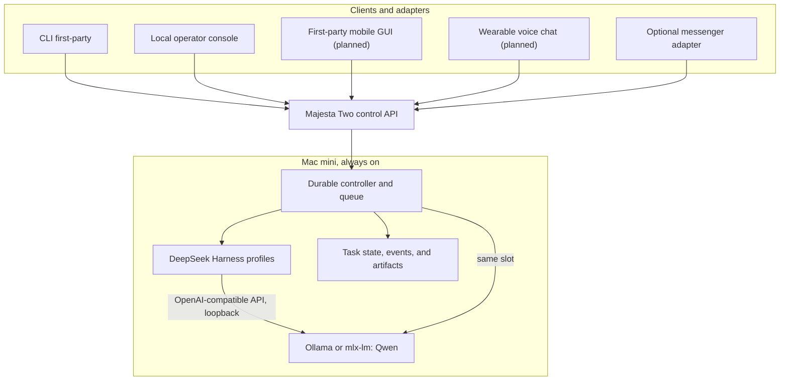
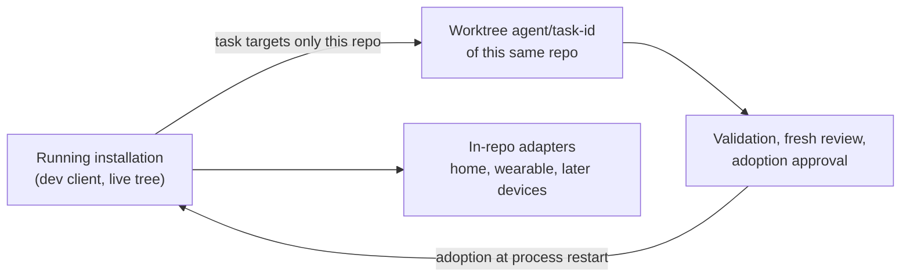
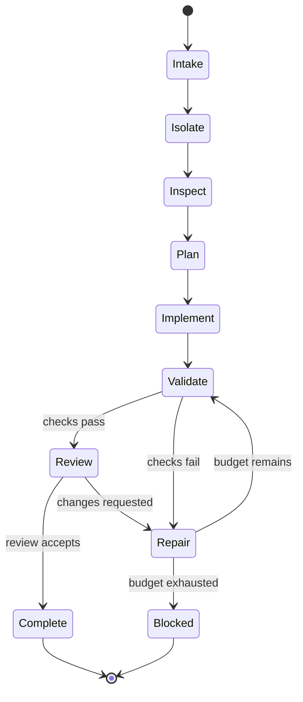

# Majesta Two

## Technical Architecture Specification

| Field | Value |
| --- | --- |
| Product | Majesta Two (`MajestaNet/two`) |
| Status | Accepted product subject (ADR 0017); Mac mini hosts the control plane (ADR 0019); adapter install menu (ADR 0021); climate tools on `home-action` (ADR 0022); direct ECHONET Lite air-conditioner transport (ADR 0027); home-action uses the pinned ACP client (ADR 0028); Samsung television tools on `home-action` (ADR 0029); Ecovacs vacuum tools on `home-action` (ADR 0038); utterance routing and device fan-out (ADR 0030); obvious device utterances compile without the harness (ADR 0036); local operator console (ADR 0031, ADR 0032, ADR 0033, ADR 0034, ADR 0035, ADR 0037, ADR 0038, ADR 0040); operator install profile (ADR 0039); operator chat approval words (ADR 0041); Ecovacs device list GET (ADR 0042); operator first-run list and pair (ADR 0043); adoption, speech, and profile preload follow |
| Version | 0.19 |
| Date | 29 October 2026 |
| Primary model | Official Qwen3.8-27B post-trained model; 4-bit default on 24 GB hosts |
| Inference host | Apple Silicon Mac; 24 GB unified memory is the default profile, not a ceiling; Ollama default, optional mlx-lm (ADR 0040) |
| Agent harness | DeepSeek Harness (`dsh`), pinned developer-preview release |
| Development host | The Mac mini, beside Ollama as separate processes (`topology: colocated`); `split` is optional when a second host stays on |

## 1. Executive decision

The system will separate **inference** from **software-development execution**. That split is **logical** (processes and trust), not a requirement for two chassis:

- Native Ollama on a Mac mini runs the official Qwen3.8 model. That mini is the always-on installation (ADR 0019). The installer selects the inference profile that fits beside the control plane. The catalog reference remains the 16K profile.
- Majesta Two and DeepSeek Harness own the source repository, shell, language servers, builds, tests, git worktrees, task state, and optional paid-model routes. They run on the same mini as separate processes from Ollama (`topology: colocated`). `split` remains optional when another host stays powered on. Linux Compose is that optional packaging, not the default.
- They call the local model through an OpenAI-compatible HTTP endpoint on `127.0.0.1`. The default server is Ollama. The operator may instead serve raw `mlx-lm` on loopback (ADR 0040). The model process never mounts the repository and never executes commands. See ADR 0006 and `two topology`.
- A durable controller around DeepSeek Harness provides a repeatable automated development lifecycle: isolate a task, inspect, plan, implement, validate, repair, review, and report. It owns the queue, checkpoints, pause/resume behavior, budgets, and recovery; the lifetime of a terminal, browser, messaging adapter, or Harness process does not define the lifetime of a task.
- A channel-neutral interaction gateway exposes the same task through the control API. The running local installation is the development client (ADR 0017). The CLI is that client's local surface and the only enabled slot in the install catalog (ADR 0021). Optional in-repo device adapters — home devices, wearables, and later private devices — are further control surfaces over the same installation. The first-party mobile GUI and the watch app are clients of this API; their native projects are not in this tree. The local operator console is the exception: it lives in this tree (ADR 0031), binds loopback, and does not replace those apps. Every client is a control surface over one durable task record, not a separate agent session.
- Large repositories are supported through retrieval and iterative work, not by placing the entire repository in the model context.

**Product subject (ADR 0017).** Majesta Two is a fully local, self-building system. The operator runs one installation of this repository. That installation is the development client and the only development subject: tasks change this tree, not unrelated projects. DeepSeek Harness stays the inner model/tool loop; its workspace is a worktree of this same repository. The executing tree is adopted from that worktree only after validation, fresh review, and an explicit approval, and only at a process restart. The open-source tree grows optional adapters for private local endpoints (home devices, wearables, and later similar devices) by that same loop.

The MVP deliberately uses one model and one inference request at a time. It does not use SSD streaming, macOS swap as working memory, automatic production deployment, or concurrent local subagents.

## 2. Goals

### 2.1 Functional goals

1. Serve an official Qwen3.8 model continuously from a Mac mini. The default profile targets 24 GB unified memory; larger hosts may select a larger context or official checkpoint.
2. Give DeepSeek Harness reliable access to model thinking, streaming, and function/tool calling.
3. Let the harness autonomously inspect and modify this repository in isolated git worktrees.
4. Support large repositories through repository discovery, lexical search, symbol navigation, bounded code excerpts, task memory, and context compaction.
5. Automate the normal development loop:
   - understand the task;
   - discover the affected code;
   - plan a bounded change;
   - implement it;
   - run deterministic validation;
   - repair failures;
   - independently review the resulting diff;
   - hand back a tested branch and report.
6. Allow optional paid specialist models later without coupling the workflow to any one provider.
7. Persist enough evidence to replay or audit what an automated task did.
8. Run bounded unattended jobs for several hours or overnight, surviving model, harness, channel, and development-host process restarts without losing repository work or blindly repeating side effects.
9. Provide a task-scoped, conversational development experience with visible plans, progress, diffs, commands, validation results, questions, approvals, and final reports through the control API (the local installation's CLI first; optional in-repo device and mobile surfaces later; optional messaging adapters remain possible).
10. Use this local installation as the development client and as the only development subject. Tasks, worktrees, reviews, and reports refer to this repository.
11. Build the next version of itself on an isolated worktree and adopt it only through validation, fresh review, and an approval of the candidate commit, applied at a process restart.
12. Grow optional in-repository adapters for private local endpoints — home devices, wearables, and later similar devices — under the control API, off until the operator enables them on that installation.
13. Run Qwen, this scaffold, and DeepSeek Harness on the Mac mini as separate processes. The installer selects the model profile that fits that machine.
14. Orchestrate later local interactions, including wearable chat and device actions, with persisted DeepSeek Harness profiles that the controller resumes. A device command uses the `home-action` profile, not the self-build profile.

### 2.2 Non-functional goals

- **Low operating cost:** reuse the existing Mac and run the development VM only when required.
- **Private by default:** prompts and repository excerpts remain on the private network unless a task explicitly permits cloud fallback.
- **Recoverable:** every task runs in a separate worktree and branch; the base checkout is not edited.
- **Deterministic completion:** the model cannot declare success without the configured validation gates being executed by the development host.
- **Replaceable components:** the model runtime, agent harness, context broker, and cloud providers communicate through explicit interfaces.
- **Stable operation:** steady-state inference must avoid sustained swap-outs and must survive process or host restarts.
- **Unattended durability:** queued and running tasks are persisted outside the Harness process, use recoverable leases and checkpoints, and do not depend on an attached terminal or browser.
- **Interaction parity:** every supported UI calls the same controller operations and projects the same authoritative task state.
- **Bounded autonomy:** every long-running loop has explicit completion criteria, hard ceilings, no-progress detection, and a safe paused or blocked state.
- **Self-safe:** the executing installation changes only by adopting a reviewed worktree at a process restart. A candidate cannot relax gates, binds, credentials, or adapter permissions until that adoption, and the approval names those changes.
- **One local copy:** inference, source, prompts, task state, and device adapters stay on the operator's machines and private network unless a task already has an explicit cloud permission.

## 3. Non-goals for the MVP

- Running the full 262K native context on the 24 GB Mac.
- Loading multiple local models at once.
- Parallel Qwen inference or parallel Qwen-backed subagents.
- Training, fine-tuning, or modifying Qwen weights.
- Giving the Ollama/inference process access to git repositories, build tools, credentials, or deployment environments (the Mac may host those processes when `topology` is `colocated`, but they stay separate from Ollama).
- Automatically merging, pushing, releasing, applying infrastructure, or deploying production changes. Post-MVP, an optional GitHub App may export the isolated task branch as a draft pull request after an explicit approval (ADR 0012, §12.7). That adapter still cannot merge, push shared branches, or deploy.
- Exposing the inference API or DeepSeek Harness UI to the public internet.
- Treating SSD or macOS swap as a substitute for unified memory.
- Building a vector database before repository-search evaluations show that one is necessary.
- Treating an unbounded prompt loop as a substitute for a durable workflow state machine.
- Sending complete source files, raw shell logs, secrets, or full model trajectories to a messaging service by default.

### 3.1 Product boundaries (ADR 0017)

These bounds stay in force after the original MVP:

- Developing unrelated repositories as the product. The development subject is this installation.
- Writing the executing tree from inside an agent turn. Self-changes are prepared on a worktree and adopted at a process restart.
- Reimplementing the DeepSeek Harness model/tool loop inside this repository.
- A second agent runtime inside a home, wearable, or other device adapter.
- Binding a device adapter to a public interface, or enabling an adapter merely because its code landed in the tree.
- Choosing a device radio, bus, vendor SDK, or speech stack in this specification. The first concrete adapter gets its own ADR.
- A device adapter opening Ollama on its own, or a chat or device turn writing a worktree, running shell, or adopting a commit.
- Loading a second local model, or a second harness binary, so chat and self-build can run at once.
- Sending a wearable or device utterance to the `self-build` profile.

## 4. Assumptions

1. “Original Qwen3.8-27B” means the official post-trained Qwen model rather than an abliterated, uncensored, merged, or task-specific derivative. The default 24 GB profile requires a 4-bit runtime representation. A larger profile may name one larger official Qwen tag after soak tests. Bootstrap pulls that profile's upstream tag only (ADR 0023). One local model remains loaded at a time.
2. In `split` topology the Mac and development host can reach each other over a trusted private LAN or overlay. In `colocated` topology the endpoint is loopback on one Mac.
3. The inference API trust boundary is that private path (LAN, overlay, or localhost). No public bind. Application auth is still required once any non-loopback client exists.
4. The Mac mini is the always-on host (ADR 0019). Ollama, this scaffold, and DeepSeek Harness run there as separate processes. The installer selects the inference profile. `split` and Linux Compose remain available when a second host stays powered on.
5. Target repositories use git and provide reproducible build/test commands or can be given an external repository profile containing them.
6. One local model stays loaded, and one inference request is in flight at a time. Self-build, chat, and device-action profiles share that slot. A non-coding turn is admitted only at a model-turn boundary and does not hold the coding lease.
7. The Mac mini remains powered on for overnight work and runs Majesta Two under a service manager rather than an interactive shell. A laptop is a client, not the durability host.
8. A remote client or messaging adapter, if enabled, is an external control and notification channel. Its outage must not stop a running job. Remote output is governed by disclosure policy. The planned remote GUI is the first-party mobile client in ADR 0015.
9. The operator's local checkout of this repository is the installation under change. Self-build tasks use worktrees of that checkout. Adoption updates the running copy only through the ADR 0017 gate.

## 5. Architecture overview



### 5.1 Trust and execution boundary

The model produces intentions and tool calls. The control plane decides whether and how those calls execute. On the default install both processes are on the Mac mini. The table is about those processes.

| Capability | Mac inference host | Development host | Remote client / external service |
| --- | --- | --- | --- |
| Model weights and decoding | Yes | No | No |
| Repository checkout | No | Yes | No |
| Shell and compiler execution | No | Yes | No |
| Git branches/worktrees | No | Yes | No |
| Test and lint execution | No | Yes | No |
| Session/task state | Minimal runtime logs | Authoritative | Task ID and permitted projection only |
| Raw source and verbose artifacts | No | Yes | Suppressed by default |
| Source-control credentials | No | Optional, policy controlled | No |
| Paid-model credentials | No | Optional, policy controlled | No |
| Client credentials | No | API verifier/configuration only | Device secure storage or service-managed identity |

This separation keeps the model process from acting outside the control plane’s policy boundary, including when both run on the mini.

### 5.2 Self-building installation

ADR 0017. The operator has one local copy of this repository. That copy is the system they run and the client they use to change it. DeepSeek Harness remains the inner loop; the product around it is this installation.



Rules:

- A task targets only the configured root of this repository.
- The agent writes only the task worktree. The executing tree stays outside that worktree.
- Completion of a self-build task produces a candidate commit. It does not install that commit.
- Adoption is a controller operation. It runs only after required validation, a fresh review with no blocking finding, and an approval whose digest is the candidate commit. It takes effect when the installation's processes restart onto that commit.
- A candidate that changes gates, bind addresses, credential policy, or adapter permissions names those changes in the adoption approval. They stay inactive in the running process that produced the candidate.
- Device adapters live in this repository, default off on each installation, and use the control API or a narrow local contract defined beside it. They do not embed a model/tool loop, and they do not receive shell, git, model credentials, or other secrets. Device traffic stays on the private network. The Ecovacs vacuum transport is the exception: it may call only `open.ecovacs.com` or `open.ecovacs.cn`, the key stays in the environment, and the harness never sees it (ADR 0038). Merging adapter code into the tree does not enable it. The install menu is `config/adapters/catalog.yaml` (`two adapters`, ADR 0021). A slot is on only when that catalog says so. Today that is the CLI alone.
- The first device protocol is climate (ADR 0022). The package is `src/two/devices/climate/`. It is shipped and default off. An install enables it with `$TWO_DATA_DIR/devices/climate.yaml`. The binding may select Home Assistant REST or a direct ECHONET Lite air conditioner (ADR 0027). Television is the second device protocol (ADR 0029). The package is `src/two/devices/tv/`. It is shipped and default off. An install enables it with `$TWO_DATA_DIR/devices/tv.yaml`. The first transport is the Samsung local API on the private LAN. Vacuum is the third device protocol (ADR 0038). The package is `src/two/devices/vacuum/`. It is shipped and default off. An install enables it with `$TWO_DATA_DIR/devices/vacuum.yaml`. The transport is the Ecovacs Open API on `open.ecovacs.com` or `open.ecovacs.cn`. The kind-level device slot stays reserved. `src/two/export/` remains the ADR 0012 reservation.

### 5.3 Mac mini installation

ADR 0019. The Mac mini is the only host the installation can guarantee will stay on. Ollama, the Majesta Two control plane, and DeepSeek Harness all run there. Ollama is a separate process on `127.0.0.1`. It does not mount the repository or execute tools. The catalog default is `topology: colocated`. `split` remains for an operator who has a second machine that stays powered on. Linux Compose is that optional packaging.

The installer selects the inference profile. `m24-qwen38-16k` stays the repository reference, not a memory gate. A larger mini may select a larger profile. If a soak shows sustained swap, the installer chooses a smaller profile. The control plane stays on the mini either way.

`two setup --plan` prints this default. `two setup --current` still prints the longer split command list.

### 5.4 Persisted harness profiles

DeepSeek Harness remains the only model/tool loop (ADR 0019). One pinned binary keeps persisted profiles. The controller resumes the profile that matches the request. A wearable utterance does not resume `self-build`.

| Profile | Tools | Example |
| --- | --- | --- |
| `self-build` | Worktree, validation, adoption gate | Change this repository |
| `operator` | Closed install tools only | Ask about this install, bind a shipped adapter, or start a worktree change |
| `home-action` | Typed device tools only | Set the air-conditioning to 20 degrees |
| `chat` | None | A conversational reply |

Profiles are persisted sessions under the local data directory. The controller may keep a profile warm so the next request resumes it without rebuilding a workspace. Warm profiles are not extra model weights and not extra harness releases. One inference stays in flight. A non-coding turn runs at a model-turn boundary and does not hold the coding lease.

A device action is a typed tool request from `home-action`. The controller performs it. The model does not open the device, the shell, or git. The action runs when local policy pre-authorizes that tool and argument, or when an approval digest matches. ADR 0022 defines the closed climate tools and the Home Assistant transport. ADR 0027 adds a direct ECHONET Lite transport for a Wi-Fi air conditioner on the private LAN. The climate tool list is the same. ADR 0029 adds the closed television tools (`tv.read`, `tv.set_power`, `tv.open`, `tv.set_volume`) on the same profile. ADR 0038 adds the closed vacuum tools (`vacuum.read`, `vacuum.clean`, `vacuum.dock`) on the same profile. A known robot is pre-authorized. The control plane calls only `open.ecovacs.com` or `open.ecovacs.cn`, and the read-back is the result. The session advertises the closed tools of each binding that is enabled. The advertisement does not perform a call, and this process does not send `execute`. Production home-action uses the pinned ACP client (ADR 0028). `operator` is a fourth persisted profile on that same client and the already selected backend (ADR 0039). Its closed tools are `install.status`, `install.read_guide`, `install.list_account`, `install.pair_device`, `install.propose_binding`, and `install.propose_change`. The control plane performs them and does not send `execute`. `install.list_account` returns vacuum nicknames without an enabled binding. `install.pair_device` stores a television token in `$TWO_DATA_DIR/env` and does not put the token in the reply (ADR 0043). A binding write and a self-build task wait for an approval digest. A later explicit `operator` transcript that is only `approve` or `approved` (or `reject` / `rejected`) may apply that stored digest for the latest awaiting turn from the same principal (ADR 0041). Silence and other sentences are not approval. The binding file is `$TWO_DATA_DIR/devices/<slot>.yaml` for climate, television, or vacuum. A code change is a task on a worktree of this repository. The coding child remains the ADR 0011 placeholder until a later slice. The CLI and the console select `operator` explicitly. An omitted profile never routes there, and the watch principal stays on `chat` and `home-action`. A client may omit the harness profile on `POST /v1/voice/turns`. The control plane then routes the transcript to `chat` or to the enabled device slots the words name, and it may repeat one closed action across every bound target of those slots (ADR 0030). An obvious single-target climate, television, or vacuum command compiles that closed tool without starting the harness (ADR 0036). Speech capture and playback stay on the client. The speech stack and the preload mechanism are a later slice.

## 6. Component architecture

### 6.1 Mac inference node

#### Responsibilities

- Run native Ollama on macOS with Apple Silicon acceleration.
- Keep one official Qwen model resident.
- Expose OpenAI-compatible chat completions, streaming, reasoning-effort control, and tool calls.
- Report model/process state for health checks.
- Restart automatically after login/reboot and preload the model.

#### Baseline model

Initial candidate:

```text
qwen3.5:9b-mlx
```

This is the official Ollama MLX tag for the 24 GB default, about 9 GB (ADR 0026). Bootstrap pulls this tag only and serves it under that same name (ADR 0023, ADR 0024, ADR 0026). The tag advertises a 262,144 context. The Ollama server sets `OLLAMA_CONTEXT_LENGTH` to the profile window so a request cannot allocate that full window. Record the upstream digest after soak. A different official tag replaces this profile's `upstream_model`. The installer does not keep a second weight set. Wider profiles may still name `qwen3.8:27b-mlx` for a larger Mac.

The architecture starts with MLX because it is the Mac-specific path. Tool-call correctness and accepted-task rate remain promotion gates for that single loaded tag.

#### Served model name

The default 24 GB profile's served name is the upstream tag:

```text
qwen3.5:9b-mlx
```

The OpenAI-compatible API cannot set context size per request. On this profile the server environment carries the window (`OLLAMA_CONTEXT_LENGTH=16384`). A profile whose alias differs from `upstream_model` still gets one local Ollama tag, for example a 32K window:

```dockerfile
FROM qwen3.8:27b-mlx
PARAMETER num_ctx 32768
```

The exact upstream model digest, Ollama version, and sampling contract are recorded in a lock file in the implementation repository.

#### Runtime profile

| Setting | MVP value | Rationale |
| --- | ---: | --- |
| Context window | 16,384 | Conservative 24/7 baseline on 24 GB unified memory |
| KV cache | `q8_0` | Approximately half FP16 KV memory with low expected quality loss |
| Flash Attention | Enabled | Reduces context-memory growth where supported |
| Loaded models | 1 | Prevents model eviction and memory overcommit |
| Parallel requests | 1 | Avoids multiplying context memory |
| Queue | 8 | Provides bounded back-pressure rather than uncontrolled demand |
| Keep alive | Indefinite | Avoids repeated model loads |
| Cloud features | Disabled | Keeps the appliance local-only |
| Input modalities | Text in MVP | Avoids unnecessary vision-path complexity |

Planned Ollama environment contract:

```text
OLLAMA_HOST=<private-mac-address>:11434
OLLAMA_CONTEXT_LENGTH=16384
OLLAMA_FLASH_ATTENTION=1
OLLAMA_KV_CACHE_TYPE=q8_0
OLLAMA_MAX_LOADED_MODELS=1
OLLAMA_NUM_PARALLEL=1
OLLAMA_MAX_QUEUE=8
OLLAMA_KEEP_ALIVE=-1
OLLAMA_NO_CLOUD=1
```

The service binds only to the trusted private-network address. It does not bind to a publicly routed interface.

#### Hardware profiles

24 GB / 16K is the **default reference profile**, not a product constraint. Named profiles live in `config/inference/profiles.yaml` and are listed by `two profiles`. Operators with 36 GB, 48 GB, or 64 GB+ unified memory may select a larger context or a larger official Qwen tag. A 16 GB host may select `m16-qwen35-4b` (`qwen3.5:4b-mlx`) or the smaller `m16-qwen35-small` (`qwen3.5:0.8b-mlx`). The local window lists unique upstream tags and a separate context window (ADR 0038). `m24-qwen38-q3` is a listed Mini trial of Qwen 3.8 27B at Q3; it is not recommended and is not the default. Changing the *repository default* is an ADR; selecting a non-default profile on one host is configuration. See ADR 0004, ADR 0034, and ADR 0038.

#### Capacity-expansion profile

A `qwen38-agent-32k` alias (`m24-qwen38-32k` or `m36-qwen38-32k`) may be evaluated after the 16K profile passes soak testing. It is not the repository default. Promotion requires:

- green macOS memory pressure under representative multi-turn tasks;
- no sustained growth in swap-outs;
- stable tool-call completion;
- no material latency regression that reduces accepted-task throughput;
- no model or Ollama termination during the 24-hour promotion soak.

#### Shared inference pool

The resident model serves every harness profile (ADR 0019, §5.4). Later local clients, including a wearable, reach it through the Majesta Two scheduler. They do not receive the Ollama address as a credential and they do not add a second loaded model. The single-request and single-model limits in this section stay in force.

### 6.2 Private network

The network supplies a stable private hostname, for example:

```text
mac-inference.internal
```

The API endpoints used are:

| Endpoint | Purpose |
| --- | --- |
| `POST /v1/chat/completions` | Model inference, streaming, tools, reasoning control |
| `GET /v1/models` | Provider discovery and conformance check; mlx-lm health when `/api/version` is absent (ADR 0040) |
| `GET /api/version` | Ollama health/version check |
| `GET /api/ps` | Ollama loaded-model and residency check |

No application authentication is added. DeepSeek Harness supplies the dummy key value `ollama` only because OpenAI-compatible clients expect a key field; Ollama and mlx-lm ignore it.

### 6.3 Development host

The development host contains eight logical components.

#### A. Majesta Two controller

A small service with a command-line client that provides the stable workflow boundary around the rapidly evolving harness.

Responsibilities:

- accept task manifests;
- expose a channel-neutral task and conversation API;
- persist a durable lifecycle state machine and task queue;
- create and retain isolated worktrees;
- launch or resume DeepSeek Harness sessions through ACP;
- supervise Harness workers with leases, heartbeats, cancellation, and restart recovery;
- select reasoning effort by workflow phase;
- enforce time, turn, diff, path, and command budgets;
- checkpoint structured state and reconcile interrupted tool actions;
- persist and walk a work graph of nodes and typed edges so longer loops stay aligned (ADR 0014);
- run independent validation outside the agent conversation;
- decide whether to continue, retry, ask for help, or stop;
- assemble the final task report;
- optionally route an allowed task to a paid model.

The controller should be small and should not reimplement the model’s agent loop. DeepSeek Harness remains responsible for model/tool interaction.

#### B. DeepSeek Harness

DeepSeek Harness provides:

- the agent loop;
- custom model-provider configuration;
- shell, editor, filesystem, LSP, plan, todo, goal, job, and session capabilities;
- workspace-write sandboxing;
- append-only session trajectories;
- context compaction;
- interactive Web UI for supervised sessions;
- ACP for programmatic/headless sessions.

The harness is currently a developer preview. The implementation must pin an exact release rather than using `latest`, and upgrades must pass the local evaluation suite before promotion.

#### C. Local Qwen provider adapter

DeepSeek Harness uses a custom OpenAI-completions provider pointing at the local OpenAI-compatible server. Ollama on `127.0.0.1:11434/v1` is the default. The operator may serve raw `mlx-lm` on `127.0.0.1:18080/v1` instead (ADR 0040). Do not install a DeepSeek Harness MLX plugin.

```yaml
llm-pi-ai:
  providers:
    mac-qwen:
      displayName: Mac mini Qwen
      apiKeyEnv: MAC_QWEN_API_KEY
      api: openai-completions
      baseURL: http://127.0.0.1:11434/v1
      compat:
        supportsDeveloperRole: false
      models:
        - id: qwen3.5:9b-mlx
          name: Qwen 3.5 9B Local 16K
          contextWindow: 16384
          maxTokens: 8192
          input: [text]
          reasoningEfforts:
            off: none
            low: low
            medium: medium
            high: high
            max: max
```

This is the default shape on the Mac mini: loopback Ollama. Optional `split` uses a private hostname instead of `127.0.0.1`. When the operator selects mlx-lm, `baseURL` is `http://127.0.0.1:18080/v1` and the model id is the profile `mlx_lm_model` (ADR 0040). The exact field set must be contract-tested against the pinned DeepSeek Harness release. In particular, tool-call serialization, system/developer roles, reasoning fields, and replay of assistant reasoning must be validated before unattended execution.

#### D. Workspace manager

The workspace manager creates one branch and git worktree per task:

```text
branch:   agent/<task-id>
worktree: <workspace-root>/<repo-id>/<task-id>
```

Rules:

- Never edit the canonical/base checkout from the agent loop.
- Never run two tasks in the same worktree.
- Retain failed and blocked worktrees for diagnosis.
- Do not delete a successful worktree until its branch and report have been handed off.
- Do not push, merge, rebase shared branches, or deploy in the MVP.
- Eventual GitHub export is a separate adapter (ADR 0012, §12.7), not a workspace-manager method and not a local git forge.

For this product the base checkout is the running installation of this repository (ADR 0017, §5.2). The agent loop still does not edit it. Adoption of a finished worktree is a separate controller operation and applies at process restart. Until subject pinning is implemented, workspace code can still open another repository; new tasks follow §5.2.

For large repositories, use a local bare mirror or canonical clone plus worktrees so task creation does not duplicate the complete repository.

#### E. Repository context broker

The context broker gives the model small, relevant, evidence-backed context packets. It is implemented initially through DeepSeek Harness filesystem/LSP tools plus controller policy; it may later become a native Harness plugin.

Retrieval order:

1. Repository and workspace instructions such as `AGENTS.md`, README files, and external repository profiles.
2. Tracked-file inventory from git, excluding generated/vendor/build directories.
3. Dependency and build manifests.
4. Lexical search with `rg` for identifiers, errors, routes, schemas, and tests.
5. Symbol definition/reference navigation through the appropriate language server.
6. Adjacent tests, callers, implementations, and configuration.
7. Git history or blame only when the task needs design intent.
8. Bounded file excerpts rather than whole files wherever possible.

The broker maintains a structured task memory outside the model transcript:

- objective and acceptance criteria;
- repository facts and commands;
- plan and current step (the durable plan is the work graph in §8.5; this field is a summary);
- files inspected and why they matter;
- files changed;
- tests executed and results;
- unresolved hypotheses;
- blockers and next actions.

This task memory is reinjected after compaction or fresh-session review. Old free-form reasoning is not treated as durable memory.

#### F. Validation and policy engine

The validation engine executes deterministic gates independently of the model’s claim of completion:

- formatting;
- linting;
- static analysis/type checking;
- targeted tests;
- broader tests where time permits;
- build/package verification;
- generated-file or schema checks;
- path and diff-policy checks;
- secret scanning where configured;
- `git diff --check` and clean status inspection.

Repository-specific commands live in an external versioned profile. An existing `AGENTS.md` remains model guidance but is not the sole machine-readable source of validation commands.

#### G. Durable job runner and supervisor

Majesta Two—not DeepSeek Harness—owns task lifetime. The runner is an operating-system service and continues when the initiating CLI exits, a browser closes, or a messaging adapter disconnects.

Each task stores a coarse lifecycle state and a separate workflow stage:

| Lifecycle state | Meaning |
| --- | --- |
| `queued` | Accepted and waiting for the single local-model execution slot |
| `running` | A worker holds a renewable lease and is advancing the workflow |
| `awaiting_input` | A material question or approval is outstanding; the inference slot is released |
| `retry_wait` | A bounded infrastructure retry is scheduled |
| `paused` | Deliberately stopped at a safe boundary with all state retained |
| `complete` | Required gates and review passed |
| `blocked` | Work cannot continue without a policy, dependency, or human decision |
| `failed` | Infrastructure or workflow execution ended without a valid continuation |
| `cancelled` | A user or policy cancelled the task; worktree and evidence remain available |

Durability rules:

- A worker obtains a time-limited lease and emits heartbeats. After restart, the scheduler reclaims only expired leases.
- Every model turn, tool request, tool result, stage transition, question, answer, approval, and cancellation is written to an append-only event log with a stable identifier.
- Before a tool action, the runner records its action identifier and intent. After execution it records exit status, relevant output, repository diff fingerprint, and resulting checkpoint.
- If a crash occurs between execution and result persistence, the task enters reconciliation. Majesta Two inspects the worktree and action evidence; it never blindly reruns an action whose outcome is unknown.
- A valid Harness session may be resumed. If it cannot be resumed, Majesta Two starts a fresh session from the objective, acceptance criteria, structured task memory, current diff, and validation evidence.
- Pause and cancellation are cooperative at safe boundaries. A non-responsive child process receives a bounded grace period before termination; its worktree is never discarded automatically.
- Waiting for a human, an unavailable Mac, or a messaging outage does not consume model turns. Active and wall-clock budgets are recorded separately.

Initial execution profiles are configuration rather than hard-coded behavior:

| Profile | Active time | Model turns | Repair cycles | No-progress limit |
| --- | ---: | ---: | ---: | ---: |
| `standard` | 90 minutes | 8 | 3 | 2 consecutive attempts |
| `overnight` | 8 hours | 30 | 6 | 2 consecutive attempts |

The overnight profile increases time for investigation, builds, and tests; it does not permit an infinite agent loop or expand change-control permissions.

#### H. Interaction gateway and channel adapters

The running installation is the development client (ADR 0017, §5.2). The interaction gateway presents one controller contract to every UI of that installation:

- create or schedule a task;
- add a message or answer to an existing task;
- inspect objective, plan, current stage, budget, todo state, diff summary, commands, tests, and blockers;
- pause, resume, or cancel;
- approve or reject a specifically described gated action;
- request a review or final report;
- open the retained worktree or branch from a development-capable client.

The Majesta Two API binds to a Unix socket or loopback interface by default.
A remote client uses authenticated HTTPS over a private overlay; the API is
never exposed directly to the public internet.

Every conversational surface binds to the stable task identifier. Follow-ups
continue that task and do not silently create new Harness sessions. A
review-only task is the no-write conversational mode; the system does not add
a second chat-agent runtime beside DeepSeek Harness.

The implemented B07 API is the CLI baseline. The additive GUI contract is
specified in [client-api-design.md](client-api-design.md) and ADR 0015. It
adds:

- client-safe conversation pagination and resumable server-sent events;
- repository and project resources with immutable, validated config
  candidates;
- persisted-graph, bounded diff/artifact, queue, and aggregate health
  projections;
- optimistic concurrency and idempotent mutations;
- server-derived principals, scoped authorization, and mobile-grade
  authentication.

The first-party mobile app calls only this API. It reaches HTTPS over a
private overlay and uses OAuth 2.1 Authorization Code with PKCE against an
operator-configured OIDC issuer; the shared CLI bearer token is not embedded
in the app. The server fails closed when trusted remote authentication is not
configured. Approval remains bound to an immutable action digest and may
require recent or local operator authentication.

Any future messenger adapter implements the same API rather than forking the
controller. It authenticates dedicated identities, maps vendor input to typed
commands, deduplicates retries, posts only policy-filtered summaries, and
remains unable to call the model, shell, git, or deployment systems directly.
Any cloud notification or messenger service is an external data processor:
payloads suppress secrets, environment values, raw trajectories, source,
approval details, and verbose logs by default.

Four kinds stay separate (ADR 0021): first-party clients, messenger adapters
(`two.channels`), device adapters (`two.devices`, reserved), and
source-control export (`two.export`, reserved). `two.providers` is the
model-provider contract, not a client. The committed catalog is the install
menu. A slot that is not `shipped` cannot be selected, and landing the
package does not enable it. The local operator console is a client in this
tree (`apps/console`, ADR 0031, ADR 0032). The catalog ships it and leaves it off.
It may resume `chat` only. Mobile and watch native projects stay elsewhere.

### 6.4 State and storage

The MVP requires no separate network database; authoritative control-plane
state uses the development host's SQLite WAL store.

| State | Storage |
| --- | --- |
| Task queue, lifecycle, leases, and budgets | SQLite in WAL mode on development host |
| Work graph (nodes, edges, cursor) | SQLite on development host (ADR 0014) |
| Questions, approvals, projects, client subscriptions, and config revisions | SQLite on development host |
| Harness trajectories | DeepSeek Harness session store/JSONL |
| Append-only controller events and reports | Filesystem plus SQLite index |
| Repository task changes | Git worktree and task branch |
| Build/test outputs | Per-task artifact directory |
| Model/runtime locks | Implementation repository |

All state directories are outside target repositories unless a repository explicitly adopts committed agent configuration. SQLite and artifact directories are backed up through development-host snapshots; a successful database commit is required before a task acknowledgement is returned to any UI.

## 7. Model interaction strategy

### 7.1 Phase-specific reasoning

Qwen3.8 thinks by default and can consume substantial time and context. The controller sets effort deliberately:

| Workflow phase | Default effort | Escalation |
| --- | --- | --- |
| Repository triage/search | Low | Medium if search is ambiguous |
| Change planning | Medium | High for architectural or cross-cutting work |
| Implementation | Medium | High only after a failed approach |
| Test-failure diagnosis | Medium | High on the final local repair attempt |
| Fresh diff review | High | Paid reviewer if allowed and still uncertain |
| Simple formatting/mechanical edits | Off or low | None |

Maximum reasoning is not the default. The objective is accepted changes per hour, not maximum tokens per answer.

### 7.2 Context budget

For the 16K model profile, a typical turn should target:

| Context element | Target budget |
| --- | ---: |
| System, tool schemas, and repository policy | 2K–3K tokens |
| Structured task memory and plan | 1K–2K tokens |
| Retrieved code and diagnostics | 5K–7K tokens |
| Reserved model output/reasoning | 5K–8K tokens |

The broker must prefer another focused model turn over stuffing more source into one prompt.

DeepSeek Harness compaction should begin before exhaustion, initially around 70–75% of the declared context. Compaction retains structured task state, recent decisions, changed files, and test evidence while dropping stale searches, duplicated tool output, and superseded reasoning.

### 7.3 Tool-result discipline

- Limit command output at the source where possible.
- Persist long build logs as artifacts and return only the failure summary plus relevant lines.
- Never put dependency directories or minified/generated assets into model context.
- Return line-numbered excerpts around search matches.
- After each edit, present the model with the diff or affected region rather than the complete repository.
- Treat compiler and test output as higher-value evidence than model speculation.

### 7.4 Sampling defaults

The official Qwen recommendations remain the starting point:

- thinking: temperature `1.0`, top-p `0.95`, top-k `20`, min-p `0.0`;
- non-thinking: temperature `0.7`, top-p `0.8`, top-k `20`.

The evaluation suite may override these only when accepted-task evidence supports the change.

## 8. Automated development workflow



### 8.1 Task manifest

Each automated task is explicit and reproducible:

```yaml
id: task-123
repository: example-service
base_ref: origin/main
objective: Add optimistic locking to order updates
acceptance_criteria:
  - Concurrent updates cannot silently overwrite each other
  - Existing API behavior remains backward compatible
allowed_paths:
  - src/**
  - tests/**
validation_profile: standard
mode: unattended
execution_profile: overnight
cloud_allowed: false
time_budget_minutes: 480
max_model_turns: 30
max_repair_cycles: 6
no_progress_limit: 2
on_human_input_required: pause
max_changed_lines: 600
```

### 8.2 Workflow stages

#### Stage 1 — Intake and policy

- Validate required fields.
- Classify the task as analysis-only, normal code change, dependency change, data migration, infrastructure, or external-side-effect work.
- Refuse or request explicit approval for out-of-policy operations.
- Establish time, turn, repair, no-progress, command, and diff budgets.
- Bind the task to its initiating conversation, if any, and acknowledge it only after durable persistence.

#### Stage 2 — Isolation

- Resolve the base commit.
- Create `agent/<task-id>` and its worktree.
- Record the original commit and repository status.
- Load the repository profile and instructions.

#### Stage 3 — Inspection

- Inventory the relevant repository structure.
- Identify build system, language servers, tests, and ownership boundaries.
- Search for affected symbols and adjacent tests.
- Write initial structured task memory.

#### Stage 4 — Plan

- Ask Qwen for a bounded implementation plan tied to acceptance criteria.
- Require named files, tests, assumptions, and rollback implications.
- In interactive mode, allow plan approval.
- In workspace-auto mode, continue only when the plan stays within the task policy.

#### Stage 5 — Implement

- Make small patches.
- Inspect the diff after each coherent change.
- Run the narrowest useful check early.
- Keep task memory synchronized with actual repository state.

#### Stage 6 — Validate and repair

- Run configured deterministic gates.
- Return concise diagnostics to the agent.
- Permit a bounded repair loop.
- Require evidence of progress between attempts; repeated identical failures stop the loop.

Initial default budgets:

- up to 3 implementation/repair cycles for a normal task;
- up to 8 significant model turns;
- up to 90 minutes active execution time;
- one explicit extension permitted by a human or policy rule.

These values are configuration, not hard-coded behavior.

For an overnight task, the `overnight` execution profile supplies the larger ceilings in Section 6.3.G. The controller may stop earlier when acceptance criteria are met, progress stalls, policy is reached, or a material decision requires human input. It may not silently extend any ceiling.

#### Stage 7 — Fresh review

Start a fresh Qwen session with:

- the original task and acceptance criteria;
- the final diff;
- relevant tests and their results;
- the structured task summary;
- no implementation conversation.

The fresh reviewer looks for missed requirements, regressions, unsafe assumptions, incomplete tests, and unnecessary changes. This reduces anchoring on the implementation session.

#### Stage 8 — Completion

The controller—not the model—sets the final status:

- `complete`: all required checks pass and review has no blocking finding;
- `blocked`: a concrete dependency, permission, ambiguity, or budget limit prevents completion;
- `failed`: infrastructure or harness execution failed without a recoverable task state;
- `cancelled`: an authorized user or policy ended the task and the retained worktree/evidence describe any partial result.

The output includes:

- branch and worktree;
- base and final commits;
- changed-file summary;
- acceptance-criteria disposition;
- commands/tests run and results;
- reviewer findings;
- remaining risks or manual steps;
- session/trajectory references;
- local and optional cloud usage metrics.

A self-build task ends this stage as a **candidate**. Stage 8 does not copy the worktree onto the executing installation. Adoption is the separate operation in §5.2.

### 8.3 Developer interaction contract

The product experience should capture the useful workflow properties of modern AI coding tools without coupling them to a particular UI or Harness implementation:

1. **One task, one durable conversation.** The task, plan, worktree, model sessions, questions, approvals, and evidence share one identifier across the CLI, first-party mobile GUI, and any future adapter.
2. **Grounded repository awareness.** Model claims and proposed changes reference concrete paths, symbols, callers, tests, and diff hunks. Search and LSP evidence are available without flooding the conversation.
3. **Clear working modes.** `review-only` answers and investigates; `interactive` proposes and asks at key boundaries; `workspace-auto` executes a bounded change; `unattended` adds durable scheduling and asynchronous escalation.
4. **Visible plan and progress.** The UI can show acceptance criteria, current stage, the work graph (nodes, edges, cursor), current todo, active command, elapsed and remaining budgets, changed files, and latest validation state without querying the model.
5. **Diff-first review.** The authoritative output is the branch/worktree diff plus validation evidence. Chat summaries never replace inspectable code changes.
6. **Checkpoints and undo.** Majesta Two records safe stage checkpoints and can restore a task to a prior checkpoint or abandon its complete worktree without touching the base checkout.
7. **Tests as first-class evidence.** Commands, exit codes, concise diagnostics, and artifact links are attached to the task. A green-looking chat response cannot override a failing gate.
8. **Background execution.** Closing a client detaches from the task; it does not cancel it. Reopening from any channel reconstructs state from Majesta Two, not from client-local history.
9. **Material interruptions only.** The agent asks when ambiguity changes the implementation materially, an approval boundary is reached, or safe progress is impossible. Questions include the decision, bounded options, a recommendation, and the effect of waiting.
10. **Clean handoff.** Completion provides the branch, diff summary, acceptance-criteria result, tests, risks, and suggested next action. The user can continue the same conversation for a follow-up task while Majesta Two creates a new isolated worktree when required. GitHub export of that branch is post-MVP (ADR 0012) and is never implied by `complete`.

The exact widgets, message blocks, slash commands, ACP calls, and Harness plugin points are implementation details. These ten behaviors are architecture-level acceptance contracts and should be tested independently of the selected UI.

### 8.4 Asynchronous questions and approvals

Questions and approvals are durable records, not ephemeral chat prompts:

- Each record includes task, workflow stage, requesting actor, reason, options, recommendation, creation time, and status.
- An approval additionally includes the exact action class, affected paths or external target, and a digest of the proposed action. Approval of one action cannot authorize a modified action.
- The task moves to `awaiting_input`, releases the local inference slot, and may notify every subscribed channel.
- The first valid authorized response resolves the record transactionally. Later or duplicate responses are acknowledged but ignored.
- Approval timeout behavior is explicit: pause indefinitely, block after a deadline, or apply a pre-authorized safe default. Silence never implies approval.
- Answers become structured task events and are supplied to the resumed Harness session with the current repository and validation state.

### 8.5 Work graph for longer-running loops

The eight-stage machine in §8.2 is **policy** (what kind of step is legal). The durable plan for a longer work item is a **persisted directed graph** of those kinds (ADR 0014):

- Nodes are bounded slices (inspect, plan, implement, validate, repair, review, decision) with their own objective, acceptance criteria, and status.
- Edges are typed connections (`depends_on`, `repairs`, `reviews`, `supersedes`, `blocks`) so humans and the next model turn can see *why* a slice is waiting.
- DeepSeek Harness remains the inner model/tool loop. The controller walks **one** READY node at a time through the existing ACP worker. Validate nodes run host gates and do not call the model. Review nodes always start a fresh session.
- After compaction or a child restart, the prompt is a graph *slice* (current node, completed predecessor summaries, dependents), not the implementation transcript and not the full graph JSON.
- Overnight still means larger ceilings, not an unbounded inner loop. Longer work is more nodes inside the task budget. Node-count and per-node turn caps are in ADR 0014; task-level budgets in §6.3.G still win.
- The linear Inspect → Plan → Implement → Validate → Review pipeline is the degenerate graph. A Plan-stage proposal may expand it. The controller commits the graph; the harness may only propose.

Clients project the graph on the control API (`TaskProjection.graph`). Implementation: `two.graph` (contract) and backlog B19 (store + walker). Do not add a second orchestrator (LangGraph, Temporal, Prefect) and do not fan out local Qwen nodes.

## 9. Automation modes

| Mode | Behavior |
| --- | --- |
| `review-only` | Read/search/analyse; no repository writes |
| `interactive` | Model proposes plans and edits; user approves key actions |
| `workspace-auto` | Default autonomous mode; unrestricted worktree edits and tests, no external side effects |
| `unattended` | Durable queued `workspace-auto` execution using `standard` or `overnight` profiles, with strict budgets and asynchronous pause/escalation |

Even in unattended mode, the MVP does not merge, push, deploy, publish packages, apply migrations, or alter external systems. Approved GitHub export of `agent/<task-id>` is post-MVP (ADR 0012) and is never implied by task completion.

## 10. DeepSeek Harness orchestration policy

### 10.1 Standard and headless paths

- Use the DSH Web UI for interactive development and trajectory inspection.
- Use DSH ACP from Majesta Two for queued/headless tasks.
- Keep both paths on the same pinned provider configuration and repository policies.
- Treat the DSH Web UI as an inspection or supervised interaction surface, not the authoritative job store. Closing it must not terminate a controller-owned task.
- Run ACP sessions as supervised children with task identifiers, health heartbeats, bounded cancellation, and resumable session references.

### 10.2 Subagents and workflows

The local Mac has one inference stream. Consequently:

- local-model subagent fan-out is disabled or serialized;
- model-authored workflows use concurrency `1` on the local route;
- parallelism is reserved for deterministic host tools such as independent lint/test commands;
- cloud-backed subagents may run concurrently only when explicitly configured and budgeted.

DeepSeek Harness’s Ralph workflow may be introduced for bounded fresh-agent repair loops. It cannot certify completion by itself: DSH documents that Ralph completion is a worker report. Majesta Two’s independent validation remains authoritative. Initial Ralph ceiling: three rounds.

## 11. Paid-model extension

The architecture allows additional DSH providers without changing the Mac endpoint.

### 11.1 Routing policy

Local Qwen remains the default. A paid route is eligible only when `cloud_allowed: true` and one of these conditions occurs:

- relevant context cannot be reduced to the local window;
- two tool-call/schema repair attempts fail;
- three code-repair cycles do not improve validation evidence;
- the task is explicitly classified for a specialist model;
- an independent external review is requested.

### 11.2 Cost and privacy controls

- Set a per-task monetary/token budget.
- Record which excerpts were sent externally.
- Prefer cloud planning or review before granting cloud models tool execution.
- Never silently escalate a `cloud_allowed: false` task.
- Keep cloud provider credentials on the development host only.

## 12. Operational architecture

### 12.1 Mac startup and recovery

The implementation will provide a native macOS launch configuration that:

1. starts Ollama with the production environment;
2. waits for `/api/version`;
3. verifies the expected model digest;
4. preloads `qwen3.5:9b-mlx` with indefinite keep-alive;
5. records startup/health failures;
6. restarts the process if it exits unexpectedly.

The Mac should be configured not to sleep while acting as an inference node and to restart after power loss where the environment permits.

### 12.2 Development-host services

Recommended processes:

- `two-api`: channel-neutral task, conversation, approval, and evidence API;
- `two-scheduler`: durable queue, leases, budgets, and recovery;
- `two-worker`: single local-model execution worker and ACP supervisor;
- pinned DeepSeek Harness runtime, launched or attached per task;
- optional DSH Web UI bound locally or to the private network;
- repository language servers and build toolchains;
- SQLite task state;
- lightweight health poller for the Mac endpoint.

The API, scheduler, worker, and any adapter the install catalog marks enabled run on the Mac mini under launchd or `two up`, with automatic restart and bounded restart backoff (ADR 0019, ADR 0021). Today the catalog enables the CLI only. Docker Compose (`deploy/compose`) remains the optional packaging when a separate Linux host stays on; a full VM is optional extra isolation. Ollama stays native on the mini in either case. The worker count for the local Qwen route is one. CLI/mobile from another network uses authenticated HTTPS over a private overlay, not a public bind. See ADR 0005, ADR 0015, `docs/channels.md`, and `docs/client-api-design.md`.

### 12.3 Health states

| State | Definition | Controller action |
| --- | --- | --- |
| Healthy | API responds, expected model loaded, memory pressure acceptable | Accept work |
| Cold | API responds but model not resident | Preload and wait |
| Busy | One request active and queue below limit | Queue one task |
| Degraded | Swap-outs rise, response stalls, or wrong model/version loaded | Stop new work; finish/cancel current work |
| Unavailable | API/network fails | Pause task and preserve state |

Automatic cloud failover is disabled unless the task explicitly permits cloud use.

### 12.4 Timeouts and retry behavior

- Fast connection timeout to identify an unavailable Mac.
- Long total inference timeout because medium/high reasoning can take minutes.
- Retry transient connection, 429, or 503 failures with bounded exponential backoff.
- Do not retry indefinitely.
- If a stream fails before a tool call is committed, retrying the model turn is safe.
- Once a tool action executes, resume from recorded tool evidence rather than replaying the action blindly.
- Track model-stream liveness separately from total turn duration so a legitimately slow reasoning turn is not mistaken for a dead process.
- Exclude explicit `awaiting_input` time from active-execution budgets while still recording total wall-clock age.

### 12.5 Startup recovery and action reconciliation

On development-host service startup, Majesta Two:

1. opens and verifies the SQLite store and event log;
2. scans non-terminal tasks and reclaims expired worker leases;
3. verifies each worktree, branch, base commit, and current diff fingerprint;
4. classifies the last action as completed, safe to retry, or requiring reconciliation;
5. checks Mac and Harness health;
6. resumes runnable tasks in queue order and leaves human-paused tasks untouched;
7. emits one recovery event and channel notification rather than constructing a new task.

Arbitrary shell commands cannot be made exactly-once across every possible host crash. Majesta Two therefore guarantees **at-most-once automatic replay**: an action with an uncertain outcome is reconciled from filesystem, git, process, and captured-command evidence or is escalated. It is never automatically issued twice merely because its result event is missing.

The Mac mini should use persistent storage with routine snapshots. It is the overnight host (ADR 0019). A laptop that sleeps is a client. A separate always-on Linux VM remains the optional `split` packaging.

### 12.6 Secure remote GUI and optional adapters

The first planned rich client is a first-party native mobile app (ADR 0015,
B14). It is detachable and reconstructs state from snapshots plus resumable
server-sent events. Its five primary views are Projects, Task conversation,
Development loop, Evidence, and System health. Once B19 persists and
populates it, the work graph—not chat prose—supplies plan topology, cursor,
readiness, and dependency reasons.

The local operator console (ADR 0031, ADR 0032, ADR 0033, ADR 0034, ADR 0035) is not that remote client.
It runs on the Mac mini, talks to loopback, and lives in this repository.
A packaged build carries this control plane, so the desktop install does not need a second clone. Opening the window starts `two up` when it is not already running. Closing the window hides it. The control plane keeps running, and the menu bar opens the window again. The window may install the official Ollama archive when no binary is found, list models that fit 16 GB, and load one operator-entered Ollama tag. It may also install the pinned DeepSeek Harness checkout (ADR 0035).

Remote access requires:

- HTTPS over a private Tailscale/WireGuard overlay; no public API bind;
- OAuth 2.1 Authorization Code with PKCE and a trusted
  operator-configured OIDC issuer;
- short-lived access tokens, rotating refresh credentials in platform secure
  storage, server-side revocation, and server-derived scopes;
- foreground, fresh-state interaction for approvals and sensitive config;
- bounded encrypted caching and minimal lock-screen disclosure.

Push is optional. APNs/FCM receives only an opaque task id and coarse event
class; the app fetches details after unlock. A notification tap, silence, or
offline action never grants approval. Closing the app, losing connectivity,
or revoking a device does not stop a controller-owned task.

Future cloud messenger adapters may still dial out and project the same
redacted API, but none is required or selected. They must not
publish the API, call the model or shell, or become a second state store.
The install menu is `config/adapters/catalog.yaml` (`two adapters`).

### 12.7 Source-control export (GitHub App; post-MVP)

Messaging adapters do not publish git. The MVP handoff remains the retained worktree, `agent/<task-id>`, and the Stage 8 report. A human may push that branch under their own identity.

After MVP, an optional GitHub App on the development host may export that **already isolated** task ref as a draft pull request. This is a source-control adapter, not a messenger and not a second workspace manager:

- Prefer a GitHub App because target repositories are already GitHub remotes. Do not add a local git forge (Forgejo/Gitea) to the default Compose stack.
- Split local git object identity (`GIT_AUTHOR_*` / `GIT_COMMITTER_*` for the agent) from remote export. DSH must not impersonate the operator’s laptop `user.name`, and must not receive GitHub tokens.
- Export is controller-owned and approval-gated. Silence is never export. Completing a task does not push.
- The adapter may push only the approved task branch (or a documented bot namespace) and open a draft PR. It cannot merge, push the default or other shared branches, release, or deploy.
- Tokens stay in environment variables on the development host, the same rule as client-verifier and adapter credentials. They never reach DeepSeek Harness, Qwen, or the target worktree.
- Package this as `two.export`, not `two.channels` (channels must not run git) and not `two.workspace` (the workspace manager keeps its no-push surface).

See ADR 0012, `docs/source-control-export.md`, and backlog B17. This section does not add a §21 MVP acceptance item.

## 13. Observability and evidence

### 13.1 Per model turn

- task/session/turn identifiers;
- provider, model alias, and model digest;
- reasoning effort;
- input/output token counts when available;
- time to first token;
- prompt and decode duration/throughput when available;
- tool calls requested, accepted, rejected, or repaired;
- finish reason and error class;
- context compaction events.

### 13.2 Per task

- elapsed time;
- number of model turns and repair cycles;
- changed lines/files;
- validation pass/failure timeline;
- final status;
- human intervention count;
- pause, resume, recovery, and reconciliation events;
- active-execution time versus total wall-clock age;
- originating channel and notification delivery state;
- cloud tokens/cost when applicable;
- accepted-task rate over the evaluation corpus.

### 13.3 Mac capacity indicators

- model residency from `ollama ps`/`/api/ps`;
- macOS memory-pressure state;
- swap usage and, more importantly, the rate of page-outs;
- process restarts and termination causes;
- queue depth and request duration.

A static non-zero swap allocation is not itself a failure. Sustained page-out growth during ordinary inference is a degradation signal.

## 14. Failure handling

| Failure | Response |
| --- | --- |
| Invalid tool-call JSON | One schema-focused repair; then fresh model turn; then block/escalate |
| Repeated identical tool call | DSH guard plus controller stop condition |
| Context overflow | Compact; create a structured handoff; resume in a fresh session |
| Mac unavailable | Pause with worktree/session intact; resume after health returns |
| Model process crash | Restart Ollama, verify digest, preload, resume last safe model turn |
| Development-host or controller restart | Reclaim expired lease, verify worktree, reconcile last action, then resume |
| Harness child crashes | Restart from valid session reference or fresh structured handoff; preserve task identity |
| Mobile/client disconnects | Continue task; reconnect from snapshot plus durable event cursor |
| Duplicate client mutation or approval | Idempotency key plus first-writer-wins resolution; stale digest fails |
| Cancellation during a command | Request cooperative termination, enforce grace timeout, record partial outcome, and reconcile before any resume |
| Test failure | Bounded diagnosis/repair loop using concise diagnostics |
| No progress across repairs | Fresh reviewer, then block or allowed paid-model escalation |
| Diff exceeds policy | Stop and request decomposition/approval |
| Write outside worktree | Deny through sandbox; mark infrastructure/policy failure |
| Harness upgrade breaks provider | Roll back pinned version and open a compatibility task |

## 15. Safety and change-control boundaries

The inference network itself has no extra application security by design. Autonomous code execution still requires filesystem and side-effect boundaries.

Default policy:

- DSH shell runs in `workspace-write` mode.
- The controller supplies only task-relevant environment variables.
- Ambient cloud, production, and deployment credentials are scrubbed.
- Network package downloads may be permitted by repository profile; external mutations are not.
- Dependency-lock changes, database migrations, infrastructure changes, and generated large diffs require explicit policy or human approval.
- Push, merge, release, deploy, email, ticket updates, and other external actions are prohibited in the MVP.
- Chat and messaging payloads are parsed into typed controller commands; raw message text is never interpolated into a shell command.
- Under the B14 remote-auth target, identity and scopes are derived by the
  API from a trusted issuer; request bodies cannot assert their own authority.
  Until then, the shared bearer token is one coarse trusted-operator
  credential, not multi-user authorization.
- Mobile, OIDC, push, and adapter credentials are not exposed to DeepSeek Harness, Qwen, build commands, or target repositories.
- GitHub App tokens, when export is enabled, follow the same rule (ADR 0012). They are not ambient credentials for the agent loop.
- Approval records are scoped to one task and one immutable action digest; broad conversational agreement is not executable authorization.
- Channel-output policy redacts secrets and suppresses raw source, full trajectories, and verbose logs by default.
- Self-build writes stay inside the task worktree of this repository. The path of the executing installation is outside workspace-write for that task.
- Adoption consumes an approval bound to the candidate commit. A changed tree, a changed adoption digest, or a policy delta that the approval does not name fails closed.
- Home, wearable, and later device adapters are denied model credentials, shell, git, and secret environment values. They cannot enable themselves by writing local configuration from inside the agent turn that added them.
- A device or chat request resumes the `home-action` or `chat` profile. It does not resume `self-build` and it does not receive workspace-write.
- `operator` is resumed only when a local operator names it. It has no shell, git, or workspace-write. A wearable request cannot select it. An approved binding writes only the data-directory device file. An approved code change is a self-build task and does not write the executing tree. Silence is not approval. A closed approval word on a later explicit operator transcript may apply the stored digest (ADR 0041).

## 16. Key architecture decisions

| Decision | Choice | Reason |
| --- | --- | --- |
| Inference location | Mac mini, native Ollama | The always-on machine; the installer selects model quality |
| Execution location | Same mini, separate processes from Ollama (ADR 0019) | The control plane has to stay up with the only host that stays on |
| Mac runtime | Native Ollama by default; optional raw mlx-lm on loopback (ADR 0040) | Mac-specific acceleration; the harness stays on the OpenAI-completions adapter |
| API boundary | OpenAI Chat Completions | Supported by Ollama, mlx-lm, and DSH custom providers; tools and reasoning included |
| Default context | 16K with q8 KV | Stable 24 GB baseline; large-repo support comes from retrieval |
| Concurrency | One local inference request | Prevents multiplied KV allocation and throughput collapse |
| Harness | DeepSeek Harness | Plugin architecture, tool loop, sessions, sandbox, workflows, ACP |
| Harness integration | Durable external Majesta Two control plane | Insulates the workflow from developer-preview churn and supplies queueing, recovery, interaction, and deterministic gates |
| Task lifetime | Majesta Two state machine, events, leases, and checkpoints | Allows overnight execution and restart recovery independent of clients or Harness processes |
| Developer experience | Task-scoped plan, progress, diff, evidence, and conversation contract | Preserves productive coding-agent workflows across replaceable clients |
| Client direction | Channel-neutral backend; CLI now, local operator console in-tree (ADR 0031), secure first-party mobile GUI later | Rich graph/config/health UX without coupling workflow state to a vendor |
| Source-control export | Optional GitHub App after approval (ADR 0012); not a local forge | Distinct agent principal on remotes that already live on GitHub; DSH never holds the token |
| Repository isolation | Git worktree per task | Recoverability and concurrent task safety |
| Long-term task memory | Structured external state plus a persisted work graph (ADR 0014) | Survives compaction without replaying long reasoning traces; longer loops keep node/edge alignment |
| Completion authority | Controller validation | Models cannot self-certify tests or acceptance criteria |
| Large-repo retrieval | Git + `rg` + LSP first | Lower complexity than premature vector infrastructure |
| Product subject | One local installation of this repository (ADR 0017) | The running copy is the development client and builds the next version of itself |
| Self-modification | Worktree candidate, then adoption at process restart | The executing tree and its privilege boundary change only by a named approval |
| Always-on install | Mac mini runs Ollama, the scaffold, and DeepSeek Harness (ADR 0019) | A laptop is a client; `split` is optional |
| Shared inference | One resident model; persisted harness profiles share the slot | Chat and device actions resume a profile; they do not open Ollama |
| Adapter install menu | Committed catalog; only the CLI is enabled (ADR 0021) | Kinds stay separate; landing a package does not turn a slot on |
| Climate tools | Closed `home-action` tools, control plane performs them (ADR 0022). ECHONET Lite is a second transport (ADR 0027). Production uses the pinned ACP client (ADR 0028) | Default off; read-back is the result; no per-brand firmware package |
| Vacuum tools | Closed `home-action` tools, control plane calls the Ecovacs Open API (ADR 0038) | Default off; a known robot is pre-authorized; read-back is the result; only the two official hosts |
| Utterance routing | Lexical route cards, then the harness on the resident model (ADR 0030). `all` repeats one closed action. An obvious named-target command compiles without the harness (ADR 0036) | No second model. A slot stays off until the install binds it |

## 17. Risks and mitigations

| Risk | Impact | Mitigation |
| --- | --- | --- |
| DSH is a developer preview | Breaking configuration/API changes | Pin release, isolate adapter, run conformance/evaluation suite before upgrades |
| Ollama/DSH reasoning or role mismatch | Failed multi-turn/tool calls | Provider contract tests; force system role; pin compatible versions |
| 18 GB model leaves limited headroom on the mini | Swap and instability | Installer selects the profile; 16K reference; one model; one request; soak before unattended use |
| Qwen overthinks simple work | Very slow tasks and context exhaustion | Phase-specific reasoning effort, output/turn budgets, iterative tasks |
| Large repository exceeds model context | Missed dependencies or poor changes | Context broker, LSP, lexical search, structured memory, task decomposition |
| Model incorrectly claims completion | Defective handoff | Independent validation and fresh-session review |
| Automated shell damages workspace | Lost work or unrelated edits | Worktree isolation, workspace-write sandbox, path/diff policy |
| Same-model reviewer shares blind spots | Defects survive review | Fresh context, deterministic checks, optional paid independent reviewer |
| Local endpoint unavailable | Task interruption | Persist task/worktree/session state; pause/resume; explicit cloud failover only |
| Long unattended loop consumes time without progress | Wasted runtime or damaging churn | Hard budgets, stage ceilings, two-attempt no-progress limit, deterministic gates, pause/block outcomes |
| Crash occurs around a shell side effect | Duplicate or ambiguous action | Intent/result action ledger, diff fingerprints, reconciliation state, no blind replay |
| Controller database or disk is lost | Task and audit-state loss | Persistent VM disk, WAL mode, filesystem artifacts, routine host snapshots, retained git worktrees |
| Mobile device is lost or compromised | Unauthorized task/source access | Short-lived scoped tokens, rotating secure-storage refresh credentials, server-side revocation, bounded encrypted cache |
| Repository or secrets leak through client/push | Privacy or credential exposure | On-demand source scope, redaction, minimal opaque notifications, no raw trajectories or environment values |
| Unauthorized or stale client action controls a task | Unsafe pause, cancellation, config, or approval | Server-derived scopes, idempotency, ETags, recent-auth policy, immutable action digests, complete audit events |
| Self-build writes the live tree or widens its own privileges | The system can disable the gates that constrain it | Worktree-only writes, adoption at restart, approval digest over the candidate commit, policy changes named in that approval |
| A device adapter becomes a second agent or a public endpoint | Lost privacy boundary or a tool loop outside the controller | In-repo adapters, default off, private network except the two official Ecovacs hosts (ADR 0038), no shell, git, or secrets; model access only as a controller chat turn |
| A voice client calls Ollama directly or a device turn uses the coding profile | The wearable becomes a second agent with repository access | `chat` and `home-action` profiles; no shell or worktree; one in-flight inference; speech stays on the device |

## 18. Evaluation and promotion gates

Before unattended use, create a representative evaluation corpus containing:

- single-file bug fix;
- multi-file feature with tests;
- unfamiliar repository navigation;
- compile/type error repair;
- flaky or misleading test output;
- tool-call argument generation;
- context compaction and session resume;
- large-repository symbol/reference search;
- forbidden-path and forbidden-command cases;
- Mac restart during a paused task;
- Harness termination immediately before and after a tool result;
- development-host controller restart while a task lease is active;
- uncertain command-result reconciliation without duplicate execution;
- mobile disconnect/reconnect, stale SSE cursor, and duplicate mutation retry;
- an overnight task that pauses for a question and resumes hours later from another channel;
- cancellation during a long-running build or test;
- a self-build candidate that changes only a worktree of this repository and leaves the executing tree unchanged until adoption.

Soak the single loaded alias from the selected profile (ADR 0023). The default is `qwen3.5:9b-mlx` at 16K/q8 KV (ADR 0026). Do not pull a second tag for comparison.

Promotion is based on:

- accepted-task rate;
- tool-call correctness;
- first-pass and eventual validation success;
- median task time;
- memory stability and swap-out rate;
- model/harness crash rate;
- review defect-detection rate;
- successful restart/resume rate;
- duplicate-side-effect count, which must remain zero in evaluation;
- time to recover an expired lease;
- question and approval delivery/resolution correctness across channels.

Raw token-generation speed is secondary.

Before promoting unattended overnight mode, the system must also pass:

- a 24-hour inference-appliance soak at representative duty cycle without sustained page-out growth or unrecovered model failure;
- an 8-hour unattended controller soak containing multiple tasks, at least one injected Harness restart, and one temporary Mac-endpoint outage;
- recovery of every retained worktree and non-terminal task after a controlled development-host reboot;
- a private-overlay client test proving that a task can be started, inspected, answered, paused, resumed, cancelled, and completed without terminal access;
- a policy test proving that a remote client cannot authorize a changed action by replaying an earlier approval.

## 19. Implementation repository shape

The tree below is the layout an installation is built from. Comments name
reserved paths that are not directories yet (ADR 0021). `two adapters`
prints which of those slots is enabled. The local operator console lives
at `apps/console` (ADR 0031, ADR 0032, ADR 0034, ADR 0035). It is a loopback client of this installation, and a packaged build includes this control plane. The window can install the pinned DeepSeek Harness checkout.
The mobile app and the watch app stay out of this tree.

```text
two/
├── apps/
│   └── console/                        # local operator window (ADR 0031, ADR 0032)
├── README.md
├── AGENTS.md
├── .env.example
├── Makefile
├── docs/
│   ├── architecture.md
│   ├── setup.md
│   ├── adapters.md                     # install menu (ADR 0021)
│   ├── channels.md
│   ├── client-api-design.md
│   ├── client-threat-model.md
│   ├── watch-client.md
│   ├── work-graph.md
│   ├── remote-access.md
│   ├── operations.md
│   ├── unattended-operations.md
│   ├── interaction-contract.md
│   ├── task-manifest.md
│   ├── source-control-export.md
│   ├── local-16k.md
│   ├── viability.md
│   ├── public-repo.md
│   ├── backlog/
│   └── adrs/
├── deploy/
│   ├── compose/                        # optional Linux control plane
│   └── systemd/
├── config/
│   ├── adapters/
│   │   └── catalog.yaml                # install menu; only cli is enabled
│   ├── inference/
│   │   └── profiles.yaml
│   ├── deploy/
│   │   └── topology.yaml
│   ├── access/
│   │   └── remote.yaml                 # bind policy; no MVP messenger
│   ├── mac/
│   ├── dsh/
│   ├── policies/
│   ├── repositories/
│   ├── examples/
│   └── runtime/
├── src/
│   └── two/
│       ├── adapters.py                 # catalog loader; starts nothing
│       ├── api/
│       ├── approvals/
│       ├── channels/                   # messenger slot; none selected
│       ├── client.py
│       ├── context/
│       ├── controller/
│       ├── edge.py                     # watch mTLS plan; not a device adapter
│       ├── evals/
│       ├── graph/
│       ├── operator/
│       ├── providers/                  # model contract; not a client slot
│       ├── recovery/
│       ├── reporting/
│       ├── runtime/
│       ├── scheduler/
│       ├── store/
│       ├── validation/
│       ├── worker/
│       └── workspace/
│       # reserved, not created until their ADR:
│       #   devices/<name>/             # device protocol ADR
│       #   export/                     # ADR 0012
├── scripts/
├── evals/
└── tests/
```

## 20. Implementation sequence

Dedicated, agent-executable slices of this sequence are tracked in
[`docs/backlog/`](backlog/README.md) (B01–B20). The phase list below
remains the authority for order and intent; backlog files must not
invent a second architecture.

### Phase 1 — Inference appliance

- Install/pin native Ollama.
- Pull both official candidate tags.
- Create the 16K alias.
- Apply single-model/single-request/q8-KV settings.
- Add launch/restart/preload behavior.
- Run inference and memory soak tests.

### Phase 2 — Harness conformance

- Pin DeepSeek Harness.
- Configure the custom Mac provider.
- Verify `/models`, streaming, reasoning efforts, tool calls, tool results, multi-turn history, and cancellation.
- Record a provider compatibility test suite.

### Phase 3 — Safe repository execution

- Build task-manifest and worktree management.
- Enable workspace-write sandboxing.
- Add repository profiles and deterministic validation.
- Implement final reports.

### Phase 4 — Large-repository context

- Add tracked-file inventory, `rg`, LSP navigation, bounded excerpts, task memory, and compaction policy.
- Measure retrieval failures before deciding whether semantic/vector retrieval is required.

### Phase 5 — Durable automated workflow

- Drive DSH through ACP.
- Add the control API, SQLite event/state model, leases, worker supervision, action ledger, reconciliation, queueing, budgets, repair cycles, fresh review, pause/resume, cancellation, and health awareness.
- Persist a work graph of nodes and edges so overnight loops longer than one implement/repair cycle stay aligned (ADR 0014, B19). This does not replace the stage machine or enable parallel local Qwen.
- Install controller services under the development host’s service manager and pass restart/recovery tests.
- Run the evaluation corpus and promote the winning model runtime.

### Phase 6 — Conversational control

- Keep the implemented API-backed CLI as the local operator surface.
- The local operator console (ADR 0031, ADR 0032, ADR 0033, ADR 0034, ADR 0035) is an in-repo window for
  this Mac. A packaged build includes this control plane. Opening it starts `two up` when needed.
  Closing the window hides it and leaves the control plane running; the menu bar opens it again.
  It can install the official Ollama archive, locate an existing binary, list installed models,
  and start `ollama serve` on loopback. It can locate or install `mlx-lm` and start
  `python -m mlx_lm server` on `127.0.0.1:18080` (ADR 0040). It can install the pinned DeepSeek Harness checkout
  when `dsh` is missing. It recommends a catalog model, including a 16 GB row,
  and can pull one operator-entered Ollama tag or Hugging Face mlx-lm id. The Model page
  groups those rows as Local Model Catalog, with Download in that section. It shows operator docs and adapter
  bindings, and sends a voice turn. The profile defaults to unset so the
  router runs, and may be set to `chat`, `home-action`, or `operator` (ADR 0033, ADR 0039).
  It is not the mobile client.
- Add the client API resources in ADR 0015: safe conversation/SSE,
  repository and project configuration, graph/evidence monitoring, aggregate
  health, idempotency, and scoped remote identity.
- Build the secure first-party native mobile client as B14. The backend must
  run without it and without an OIDC issuer.
- Persist and resume harness profile `chat` on the single inference slot
  (ADR 0019, ADR 0021, B20). Execute the closed climate tools on
  `home-action` in the control plane (ADR 0022, ADR 0028, B21). A binding may
  speak ECHONET Lite to a Wi-Fi air conditioner (ADR 0027). The climate
  slot stays off until a local binding enables it. Execute the closed
  television tools on the same profile when a Samsung binding is enabled
  (ADR 0029). That slot stays off until the binding enables it. Execute
  the closed vacuum tools on the same profile when an Ecovacs binding is
  enabled (ADR 0038). That slot stays off until the binding enables it.
  The transport may call only the two official Open API hosts. This
  slice is not a GUI and does not add a second agent loop.
- Pass private-overlay disconnect, revocation, duplicate-mutation,
  authorization, stale-approval, disclosure, and no-terminal workflow tests.

### Phase 7 — Optional paid routes

- Add provider abstraction, explicit `cloud_allowed` policy, budgets, redaction/evidence reporting, and fallback triggers.

### Phase 8 — Optional source-control export

- Inject a local agent git identity so worktree commits are not the operator’s ambient `user.name`.
- Add an optional GitHub App adapter that, after a digest-scoped approval, pushes only `agent/<task-id>` and opens a draft pull request (ADR 0012).
- Keep `two.workspace` without push/merge APIs. Do not merge, push shared branches, or deploy. Do not add a local git forge to the default host.
- The backend must run without any GitHub App, mobile client, or optional messenger.

## 21. MVP acceptance criteria

The first repository implementation is complete when:

Items 13–20 are future full-product gates. The current CLI/B07 baseline does
not satisfy the first-party mobile, scoped-identity, or remote-disclosure
parts (13–17), subject pinning and adoption (18–19), or the seamless install
and shared chat slot (20). Items 13–17 remain open until B14's API and
native-client slices are implemented and promoted. Items 18–19 remain open
until the ADR 0017 slice is implemented and promoted. Item 20 remains open
until the ADR 0018 slice is implemented and promoted. B20 is the
`chat` profile resume. B21 executes climate on `home-action` and does
not close item 20. B25 executes the closed vacuum tools (ADR 0038) and
does not close item 20: slot priority past chat, then operator, then home-action, speech,
and the seamless install remain open.

1. The Mac automatically starts Ollama, loads the expected Qwen model, and serves it on the private network.
2. The model remains resident and the Mac shows no sustained swap-out growth or unrecovered failure during the 24-hour promotion soak.
3. DeepSeek Harness can stream a response, select reasoning effort, request a tool, receive its result, and continue the same turn through the Mac endpoint.
4. A task manifest creates an isolated branch/worktree and cannot write outside it.
5. The automated workflow can complete a fixture bug fix, execute tests, repair one induced failure, and produce a final tested report.
6. A failed or interrupted task can resume without losing its worktree or task state.
7. A fresh review session receives only the task, diff, structured state, and validation evidence.
8. The controller will not mark a task complete when required checks fail.
9. The implementation pins Ollama, DeepSeek Harness, model aliases/digests, and provider contract tests.
10. Cloud access cannot occur unless the task manifest explicitly permits it.
11. An `overnight` task can run for at least eight hours without an attached terminal or browser, while hard budgets and no-progress limits remain enforced.
12. Restarting the controller, worker, Harness child, or Mac endpoint preserves the task and worktree and resumes from a safe checkpoint or reconciliation state without automatically duplicating a tool action.
13. CLI, first-party mobile GUI, and any future adapter project the same authoritative task, plan, status, questions, approvals, diff summary, tests, and final report.
14. An authenticated first-party client can create or continue a task, answer a question, approve a specifically scoped action, and issue status, pause, resume, cancel, diff, and test requests without direct access to the model or shell.
15. Closing or disconnecting every UI leaves an unattended task running; an adapter outage affects notifications only.
16. Unauthorized client identities, duplicate mutations, stale resource revisions, stale approvals, and altered action digests cannot control or authorize a task.
17. Remote client and notification output suppresses secrets, environment values, full trajectories, source, approval details, and raw verbose logs by default.
18. A task prepares a change to this installation only in an isolated worktree of this repository, and the executing tree stays unchanged until an explicit adoption at a process restart.
19. An in-repo device adapter, when present, stays off until locally enabled, reaches only the private network, and cannot call shell or git, or read secrets. Model access, when a later chat adapter has it, is only a controller-mediated turn.
20. A live install runs Qwen, this scaffold, and DeepSeek Harness on the Mac mini as separate processes. A later device or chat turn resumes its own harness profile on the single inference slot and does not receive the self-build worktree.

## 22. References

- [Official Qwen3.8-27B model card](https://huggingface.co/Qwen/Qwen3.8-27B)
- [Official Ollama Qwen3.5-9B MLX tag](https://ollama.com/library/qwen3.5:9b-mlx)
- [Official Ollama Qwen3.8-27B MLX tag](https://ollama.com/library/qwen3.8:27b-mlx)
- [Ollama Qwen3.8 tag catalogue](https://ollama.com/library/qwen3.8/tags)
- [Ollama OpenAI compatibility](https://docs.ollama.com/api/openai-compatibility)
- [Ollama runtime, concurrency, Flash Attention, and KV-cache settings](https://docs.ollama.com/faq)
- [DeepSeek Harness official repository](https://github.com/deepseek-ai/deepseek-harness)
- [DeepSeek Harness architecture overview](https://deepseek.com/harness/en/)
- [DeepSeek Harness custom-provider guide](https://deepseek-harness.github.io/deepseek-harness/en/guide/providers)
- [DeepSeek Harness process sandbox](https://deepseek-harness.github.io/deepseek-harness/en/reference/subsystems/sandbox)
- [DeepSeek Harness ACP automation interface](https://github.com/deepseek-ai/deepseek-harness/blob/master/packages/acp/acp/README.md)
- [DeepSeek Harness Ralph workflow](https://github.com/deepseek-ai/deepseek-harness/blob/master/packages/workflow/tool-ralph/README.md)
- [Majesta Two work graph (ADR 0014)](adrs/0014-persisted-work-graph.md)
- [Majesta Two first-party client API (ADR 0015)](adrs/0015-first-party-client-api.md)
- [Majesta Two local self-building installation (ADR 0017)](adrs/0017-local-self-building-system.md)
- [Majesta Two seamless Mac install and shared inference (ADR 0018)](adrs/0018-seamless-mac-install-and-shared-inference.md)
- [Majesta Two mini-resident control plane (ADR 0019)](adrs/0019-mini-resident-control-plane.md)
- [Majesta Two single upstream model (ADR 0023)](adrs/0023-single-upstream-model.md)
- [Majesta Two serve the upstream model tag (ADR 0024)](adrs/0024-serve-upstream-model.md)
- [Majesta Two chat ACP client (ADR 0025)](adrs/0025-chat-acp-client.md)
- [Majesta Two default Qwen 3.5 9B (ADR 0026)](adrs/0026-default-qwen35-9b.md)
- [Majesta Two climate tool contract (ADR 0022)](adrs/0022-climate-device-protocol.md)
- [Majesta Two direct air-conditioner transport (ADR 0027)](adrs/0027-echonet-air-conditioner.md)
- [Majesta Two home-action ACP client (ADR 0028)](adrs/0028-home-action-acp-client.md)
- [Majesta Two Samsung television tools (ADR 0029)](adrs/0029-samsung-tv.md)
- [Majesta Two Ecovacs vacuum tools (ADR 0038)](adrs/0038-ecovacs-vacuum.md)
- [Majesta Two utterance routing and device fan-out (ADR 0030)](adrs/0030-utterance-routing-and-fanout.md)
- [Majesta Two compile an obvious device utterance (ADR 0036)](adrs/0036-closed-utterance-compile.md)
- [Majesta Two local operator console (ADR 0031)](adrs/0031-local-operator-console.md)
- [Majesta Two console uses the existing Ollama (ADR 0032)](adrs/0032-console-existing-ollama.md)
- [Majesta Two console voice profile (ADR 0033)](adrs/0033-console-voice-profile.md)
- [Majesta Two installable console (ADR 0034)](adrs/0034-installable-console.md)
- [Majesta Two console harness install (ADR 0035)](adrs/0035-console-harness-install.md)
- [Majesta Two OpenRouter inference backend (ADR 0037)](adrs/0037-openrouter-inference-backend.md)
- [Majesta Two console model list and independent context (ADR 0038)](adrs/0038-console-model-and-context.md)
- [Majesta Two operator install profile (ADR 0039)](adrs/0039-operator-install-profile.md)
- [Majesta Two mlx-lm OpenAI adapter (ADR 0040)](adrs/0040-mlx-lm-openai-adapter.md)
- [Majesta Two operator chat approval (ADR 0041)](adrs/0041-operator-chat-approval.md)
- [Majesta Two Ecovacs device list GET (ADR 0042)](adrs/0042-ecovacs-device-list-get.md)
- [Majesta Two operator first-run steps (ADR 0043)](adrs/0043-operator-first-run-steps.md)
- [OIDC/JWT and TLS dependencies (ADR 0016)](adrs/0016-oidc-jwt-tls-dependencies.md)
- [Client API threat model](client-threat-model.md)
- [OAuth 2.0 for Native Apps (RFC 8252)](https://www.rfc-editor.org/rfc/rfc8252)
- [OAuth 2.0 Authorization Server Issuer Identification (RFC 9207)](https://www.rfc-editor.org/rfc/rfc9207)
- [Server-Sent Events](https://html.spec.whatwg.org/multipage/server-sent-events.html)
- [GitHub Apps](https://docs.github.com/en/apps/creating-github-apps/about-creating-github-apps/about-creating-github-apps)
